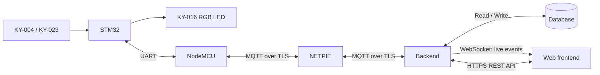

# Embedded System Final Project

An IoT system that uses an STM32 to read a button and joystick, control an RGB LED, and communicate with a NodeMCU connected to NETPIE Cloud. A website displays device data and supports a simple game.

This document describes a **proposed architecture for a team of three**. The repository currently contains a starter folder structure, with no runnable firmware or application. The game rules have not been finalized.

## 1. Scope and Hardware

| Component | Role |
| --- | --- |
| STM32 NUCLEO-F411RE | Read inputs, process data, control outputs, and communicate over UART |
| NodeMCU (ESP8266) | Exchange UART messages and connect to Wi-Fi and NETPIE over MQTT |
| KY-004 Key switch | Button input |
| KY-023 Joystick | X/Y axis inputs and an optional joystick button input |
| KY-016 RGB LED | Color output or game status indicator |

**Wi-Fi board: NodeMCU (ESP8266).** Select the board configuration and pinout that match the physical board.

## 2. System Architecture

### Target System: Web Game



NETPIE handles communication with the device, while the team's backend handles data storage. The website calls the backend API, so NETPIE credentials do not need to be stored in the browser.

### Alternative for an Initial Monitoring Milestone

```text
STM32 → NodeMCU → NETPIE Device Shadow → Web frontend
```

## 3. Team Responsibilities

| Member | Area | Suggested Tools | Deliverables |
| --- | --- | --- | --- |
| Member 1 | `firmware/stm32/` and wiring | STM32CubeIDE / CubeMX, C, HAL | Input readings, LED control, button debouncing, UART communication, and timing on the device |
| Member 2 | `firmware/nodemcu/` and NETPIE connectivity | Arduino IDE or PlatformIO, C/C++ | Wi-Fi/MQTT connectivity, UART ↔ MQTT message handling, Shadow updates, and reconnection |
| Member 3 (you) | `frontend/`, `backend/`, and data storage | React + Vite and Node.js + Express are suggested; choose a database when backend development starts | Web game, live device status, game-session APIs, score validation, and leaderboard |

## 4. Folder Structure

```text
Embedded-System-Final-Project/
├── README.md
├── .gitignore
├── firmware/
│   ├── stm32/                 # Member 1: CubeIDE project (.ioc, Core/, Drivers/, etc.)
│   └── nodemcu/               # Member 2: ESP8266; choose Arduino or PlatformIO
├── frontend/                  # Member 3: Web game, device data, and leaderboard
├── backend/                   # Member 3: API, MQTT client, and data storage
└── docs/
    └── protocol-examples.md   # UART / MQTT examples for discussion and experiments
```

Choose the database and organize data storage when backend development starts. Add application subfolders and tests later as needed.

## 5. Data Communication Examples

See [Protocol Examples](docs/protocol-examples.md) for UART communication between the STM32 and ESP8266, MQTT communication through NETPIE, and sample JSON payloads and topics.

These are **examples only, not the team's final protocol specification**. Agree on the message formats before integrating the actual system.

## References

- [NETPIE 2020 with NodeMCU — Connecting an ESP8266 to NETPIE (Thai)](https://netpie.io/tutorials/th/NETPIE2020withNodeMCU)
- [NETPIE documentation](https://docs.netpie.io/)
- [NETPIE REST API](https://docs.netpie.io/en/device-api.html)
- [NETPIE MQTT topics](https://docs.netpie.io/en/mqtt-api.html)
- [NETPIE Device Shadow / Schema](https://docs.netpie.io/en/device-config.html)
